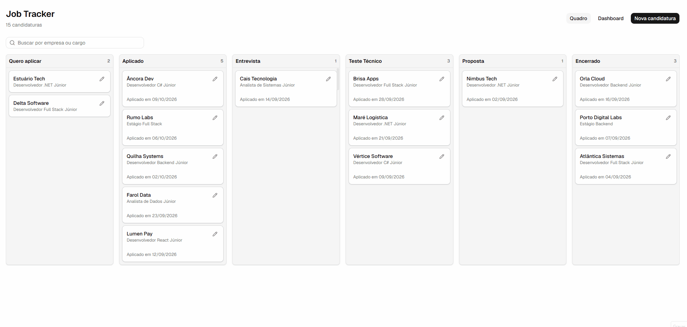
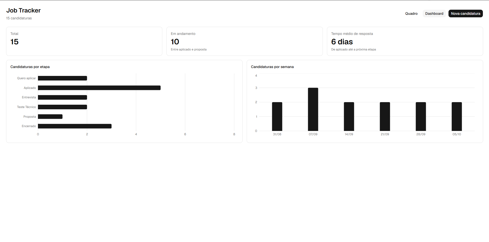
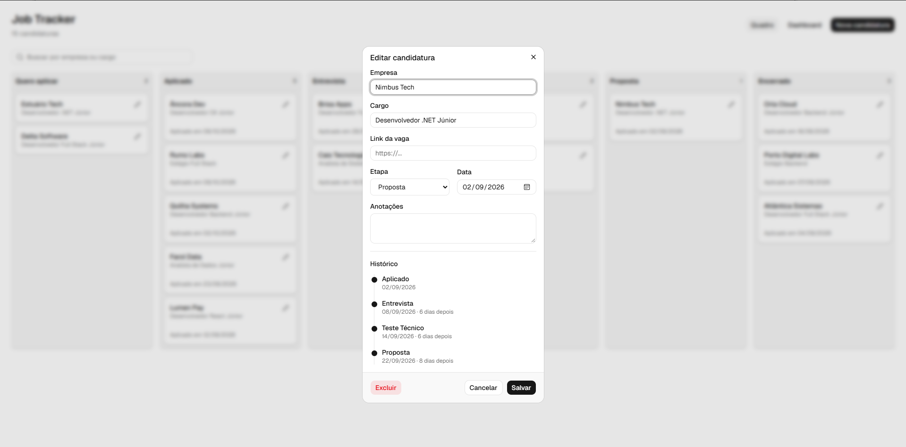

# Job Tracker

Organizador de processos seletivos em formato Kanban.



## O que ele faz

- **Quadro Kanban** com as etapas do processo (Quero aplicar, Aplicado, Entrevista, Teste técnico, Proposta, Encerrado). Arrastar o card muda a etapa e salva na hora.
- **Cadastro e edição** de candidaturas com empresa, cargo, link da vaga, data e anotações.
- **Histórico de etapas**: toda mudança fica registrada, e ao abrir uma candidatura aparece a linha do tempo com as datas e quantos dias se passaram entre uma etapa e outra.
- **Dashboard** com candidaturas por etapa, candidaturas por semana e tempo médio de resposta das empresas.
- **Busca** por empresa ou cargo direto no quadro.

| Dashboard | Histórico |
|---|---|
|  |  |

## Tecnologias

**Back-end:** .NET 10, ASP.NET Core, Entity Framework Core, PostgreSQL, xUnit

**Front-end:** React, TypeScript, Vite, Tailwind CSS, shadcn/ui, Kibo UI (Kanban com dnd-kit), Recharts

**Infra:** Docker Compose, Nginx, GitHub Actions

## Como rodar

Só precisa do Docker instalado.

```bash
git clone https://github.com/guilhermecorreiafh/job-tracker.git
cd job-tracker
docker compose up -d --build
```

Depois é só abrir **http://localhost:3000**.

O Docker Compose sobe o banco, a API e o front, e a API já cria o banco e preenche com candidaturas fictícias pra dar pra ver o quadro e o dashboard funcionando.

## Desenvolvimento local

Pra rodar com hot reload, sobe só o banco pelo Docker e roda a API e o front separados:

```bash
docker compose up -d db
dotnet run --project api
```

Em outro terminal:

```bash
cd web
npm install
npm run dev
```

O front abre em http://localhost:5173 e o Vite repassa as chamadas `/api` pra API. A documentação da API (Scalar) fica em http://localhost:5009/scalar.

### Testes

Testes de unidade das regras de domínio:

```bash
dotnet test
```

Testes de ponta a ponta com Playwright (precisam da stack rodando pelo Docker):

```bash
cd web
npx playwright install chromium
npm run test:e2e
```

Os dois rodam no GitHub Actions a cada push.

Os testes rodam também no GitHub Actions a cada push.

## Algumas decisões do projeto

- **Histórico como tabela própria.** Em vez de guardar só a etapa atual, cada mudança vira um registro em `StageChanges`. É isso que permite a linha do tempo e o cálculo do tempo médio de resposta. Quando criei essa tabela, as candidaturas que já existiam ganharam o registro inicial por uma migration de dados.
- **Regra de negócio na entidade.** A mudança de etapa passa pelos métodos `StartAt` e `MoveTo` da própria `JobApplication`, que decidem quando registrar no histórico (mover pra mesma etapa não gera registro, por exemplo). Assim a regra fica num lugar só e dá pra testar sem banco.
- **Etapas salvas como texto.** O enum vai pro banco como string (`Applied`, `Interview`...), o que deixa as consultas direto no banco legíveis e não quebra se a ordem do enum mudar.
- **Nginx na frente.** Em produção o Nginx entrega o front e repassa `/api` pra API, fazendo o mesmo papel do proxy do Vite em desenvolvimento. Assim o front sempre chama `/api` e não precisa de CORS.

## Estrutura

```
api/        API em ASP.NET Core
tests/      testes com xUnit
web/        front em React
docs/       imagens do README
```

## Licença

[MIT](LICENSE)